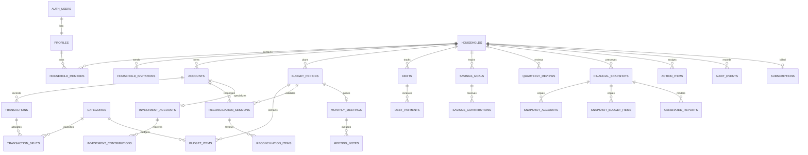

# Database and Data Model

> **Classification:** Internal  
> **Authority:** Persistent data model authority  
> **Audience:** Founder and Cursor  
> **Status:** Founding MVP baseline  
> **Last reviewed:** 2026-07-21


## 1. Modelling rules

- PostgreSQL is the source of truth; application types are generated or checked against schema contracts.
- Primary keys use UUIDs. Consider time-sortable UUIDs only after confirming Supabase/PostgreSQL support and operational value.
- Timestamps are `timestamptz` in UTC; household timezone determines reporting date boundaries.
- Calendar periods use `date`, not local midnight timestamps.
- Monetary amounts use signed `bigint` **minor units** and a separate `char(3)` currency code. Never use JavaScript `number` for unbounded minor-unit arithmetic; parse database bigint to `bigint` or a deliberate money type.
- Rates use constrained PostgreSQL `numeric`, represented in TypeScript through a decimal-safe parser/string contract.
- Every household row has direct `household_id` unless a narrowly justified ownership path can be enforced efficiently and tested. Redundancy is acceptable when a constraint/trigger guarantees consistency and it simplifies RLS.
- Operational rows may be mutable while open. Closed snapshot rows are append-only.
- Use `archived_at` for inactive operational records and governed workflows for deletion.
- JSONB is for bounded metadata, provider payload fragments and versioned summaries—not a substitute for relational columns.

## 2. Preliminary entity-relationship diagram



The diagram omits some links for readability. The migration design must define every foreign key explicitly and choose delete actions deliberately.

## 3. Table catalogue

### `profiles`

- **Purpose:** Application profile linked one-to-one to `auth.users`.
- **Important columns/types:** `user_id uuid PK/FK` → `auth.users(id)`; `display_name text`; `locale text` default `en-CA`; `timezone text` default `America/Edmonton`; `created_at timestamptz`; `updated_at timestamptz`.
- **Relationships:** One auth user; many memberships (Sprint 3+).
- **Constraints:** Display length; valid locale/timezone format; timestamps.
- **Indexes:** PK; optional lower display/search index only if needed.
- **Unique constraints:** One profile per auth user (`user_id` PK).
- **Household ownership:** User-owned, not household-owned.
- **Create strategy (Sprint 2 Checkpoint 1):** Trigger on `auth.users` insert creates the row; application may idempotently ensure. Exactly one profile per auth user.
- **Archive/deletion:** Delete with auth user after retention workflow; audit references use opaque actor ID.
- **RLS considerations:** User may `select`/`insert`/`update` own profile only (`auth.uid() = user_id`); no `anon` policies; no public-read policy; household peers receive only a deliberately exposed member view later—not full profile table SELECT for others.
### `households`

- **Purpose:** Tenant/workspace and default financial settings.
- **Important columns/types:** `id uuid PK`; `name text`; `country_code char(2)`; `province_code text`; `default_currency char(3)`; `timezone text`; `status household_status`; `created_by uuid`; timestamps; `deleted_at`.
- **Relationships:** Many members and all household domain rows.
- **Constraints:** Valid status; immutable/default-currency policy after financial data exists.
- **Indexes:** PK; status; created_by.
- **Unique constraints:** No normalized global name uniqueness.
- **Household ownership:** Root household owner.
- **Archive/deletion:** Soft-delete/tombstone then governed hard delete; snapshots retained until household deletion completes.
- **RLS considerations:** Membership-based select; owner-only protected updates/deletion.
### `household_members`

- **Purpose:** Authorized user-to-household relationship.
- **Important columns/types:** `household_id uuid`; `user_id uuid`; `role household_role`; `status member_status`; `joined_at`; `removed_at`; `invited_by`.
- **Relationships:** FK household/profile; composite identity.
- **Constraints:** Role/status checks; cannot leave household with zero active owners (transactional invariant).
- **Indexes:** PK/unique `(household_id,user_id)`; index `(user_id,status)`.
- **Unique constraints:** One membership per user/household.
- **Household ownership:** Household via `household_id`.
- **Archive/deletion:** Status/remove, do not erase historical actor relationships.
- **RLS considerations:** Member can read own active memberships; household rows depend on active membership; role changes owner-only.
### `household_invitations`

- **Purpose:** Single-use invitation lifecycle without premature membership.
- **Important columns/types:** `id uuid`; `household_id`; `email_normalized`; `role`; `token_hash`; `expires_at`; `accepted_at`; `revoked_at`; `invited_by`; timestamps.
- **Relationships:** Household and inviter; optional accepted user.
- **Constraints:** Hash unique; allowed role; expiry after creation; one active invitation policy.
- **Indexes:** Unique `token_hash`; partial index active email+household; expires index.
- **Unique constraints:** No duplicate active invitation for normalized email/household.
- **Household ownership:** Household via FK.
- **Archive/deletion:** Retain minimal audit metadata; remove token hash after retention.
- **RLS considerations:** Owner CRUD; token acceptance through security-definer function/server flow that discloses minimal data.
### `accounts`

- **Purpose:** Assets/liabilities and ledger/valuation containers.
- **Important columns/types:** `id`; `household_id`; `name`; `account_type`; `institution_name`; `currency_code`; `include_in_net_worth bool`; `balance_method`; `opened_on`; `closed_on`; `archived_at`; timestamps.
- **Relationships:** Transactions, snapshots, reconciliations; optional debt/investment specialization.
- **Constraints:** Valid dates; type/method compatibility; name length.
- **Indexes:** `(household_id,archived_at)`; type; trigram/search only if justified.
- **Unique constraints:** Optional unique normalized active name per household, but duplicates may be allowed with warning.
- **Household ownership:** Direct `household_id`.
- **Archive/deletion:** Archive; hard delete only before dependencies exist.
- **RLS considerations:** Member read; editors write; owner rules for destructive operations.
### `account_balance_snapshots`

- **Purpose:** Dated operational valuations/balances, distinct from closed financial snapshots.
- **Important columns/types:** `id`; `household_id`; `account_id`; `as_of_date date`; `amount_minor bigint`; `currency_code`; `source`; `created_by`; timestamps.
- **Relationships:** Account; may feed current net worth.
- **Constraints:** Currency matches account unless explicit future FX design; amount bigint.
- **Indexes:** `(account_id,as_of_date desc)`; household/date.
- **Unique constraints:** Unique `(account_id,as_of_date,source)` as appropriate.
- **Household ownership:** Direct and account-derived household must match.
- **Archive/deletion:** Append/correct before close; closed reporting copies values separately.
- **RLS considerations:** Household RLS plus account ownership consistency trigger/check function.
### `categories`

- **Purpose:** Household/system classification tree.
- **Important columns/types:** `id`; `household_id nullable` for system seed; `kind`; `name`; `normalized_name`; `parent_id`; `essentiality`; `system_code`; `archived_at`; sort order.
- **Relationships:** Budget items and transaction splits.
- **Constraints:** Valid kind; parent same household/kind; no cycles; system rows immutable.
- **Indexes:** Household/kind/active; parent; system_code.
- **Unique constraints:** Unique active normalized name within household/parent/kind; unique system code.
- **Household ownership:** Household row or global read-only seed.
- **Archive/deletion:** Archive used rows; never delete referenced categories.
- **RLS considerations:** Members read system and own household; editors manage only household rows.
### `transactions`

- **Purpose:** Ledger-level financial event.
- **Important columns/types:** `id`; `household_id`; `account_id`; `occurred_on`; `posted_on`; `amount_minor bigint`; `currency_code`; `description`; `merchant_normalized`; `status`; `review_status`; `cleared_at`; `transfer_group_id`; `import_row_id`; `created_by`; timestamps; `archived_at`.
- **Relationships:** Account, splits, imports, transfer counterpart.
- **Constraints:** Nonzero bounded amount; currency/account match; closed-period mutation guard.
- **Indexes:** Account/date; household/date; review; transfer group; merchant rule lookup.
- **Unique constraints:** Import fingerprint uniqueness scoped by import/account when committed; idempotency key where used.
- **Household ownership:** Direct and account ownership must match.
- **Archive/deletion:** Reverse/archive operational errors; closed changes use correction workflow.
- **RLS considerations:** Household RLS; editor mutation; server validates period state.
### `transaction_splits`

- **Purpose:** Category allocation of one transaction.
- **Important columns/types:** `id`; `household_id`; `transaction_id`; `category_id`; `amount_minor`; `memo`; timestamps.
- **Relationships:** Parent transaction/category.
- **Constraints:** Sum equals parent under chosen signed convention; same household; category compatible.
- **Indexes:** Transaction; household/category/date via joins as needed.
- **Unique constraints:** Optional one implicit split rule; unique ID.
- **Household ownership:** Direct household and both parents must match.
- **Archive/deletion:** Delete/recreate atomically before close; copied into snapshots.
- **RLS considerations:** Same transaction permissions; enforce ownership in DB function/trigger.
### `categorization_rules`

- **Purpose:** Simple household rules that propose category/split.
- **Important columns/types:** `id`; `household_id`; `name`; `priority`; `match_type`; normalized pattern; optional account; `category_id`; `enabled`; timestamps.
- **Relationships:** Category/account.
- **Constraints:** Safe bounded pattern; no arbitrary executable expressions; same household.
- **Indexes:** Household/enabled/priority; account.
- **Unique constraints:** Unique normalized name per household.
- **Household ownership:** Direct.
- **Archive/deletion:** Archive/disable; retain applied result separately.
- **RLS considerations:** Editors manage; all matching occurs within household.
### `recurring_bills`

- **Purpose:** Expected recurring obligation for upcoming area.
- **Important columns/types:** `id`; `household_id`; `name`; `category_id`; optional `account_id`; `amount_minor`; `currency_code`; recurrence rule; next due; active; reminder settings.
- **Relationships:** Category/account; future notifications.
- **Constraints:** Bounded recurrence grammar; positive expected amount; currency compatibility.
- **Indexes:** Household/next_due/active.
- **Unique constraints:** Optional normalized active name.
- **Household ownership:** Direct.
- **Archive/deletion:** Deactivate/archive; history remains through actual transactions.
- **RLS considerations:** Editor write; member read.
### `budgets`

- **Purpose:** Reusable budget definition/template.
- **Important columns/types:** `id`; `household_id`; `name`; `currency_code`; `is_template`; `archived_at`; timestamps.
- **Relationships:** Budget periods/items.
- **Constraints:** Valid currency; one default template if used.
- **Indexes:** Household/active/template.
- **Unique constraints:** Optional normalized name unique.
- **Household ownership:** Direct.
- **Archive/deletion:** Archive; do not delete periods.
- **RLS considerations:** Editors manage.
### `budget_periods`

- **Purpose:** One household monthly plan and lifecycle.
- **Important columns/types:** `id`; `household_id`; optional `budget_id`; `period_start date`; `period_end date`; `currency_code`; `status`; `notes`; `closed_snapshot_id`; timestamps.
- **Relationships:** Budget items, meeting, reconciliation, close.
- **Constraints:** Non-overlap/one canonical month; start<=end; status transition guard.
- **Indexes:** Unique `(household_id,period_start,currency_code)`; status.
- **Unique constraints:** Canonical one period per month/currency.
- **Household ownership:** Direct.
- **Archive/deletion:** Never delete once closed; open unused period may be removed with guard.
- **RLS considerations:** Members read; editors edit open; close owner per permission decision.
### `budget_items`

- **Purpose:** Planned category amount for a period.
- **Important columns/types:** `id`; `household_id`; `budget_period_id`; `category_id`; `planned_minor bigint`; `note`; optional essentiality override; sort.
- **Relationships:** Period/category; snapshot copy.
- **Constraints:** Same household; valid category kind; closed guard.
- **Indexes:** Period/category; household.
- **Unique constraints:** Unique `(budget_period_id,category_id)` unless sub-lines intentionally supported.
- **Household ownership:** Direct and parent match.
- **Archive/deletion:** Mutable only while open; copied immutable at close.
- **RLS considerations:** Editor write open; member read.
### `reconciliation_sessions`

- **Purpose:** Statement reconciliation header per account/period.
- **Important columns/types:** `id`; `household_id`; `budget_period_id`; `account_id`; `statement_date`; `statement_balance_minor`; `application_balance_minor`; `difference_minor`; `status`; exception reason/approver/time; started/completed by/time.
- **Relationships:** Items; period/account.
- **Constraints:** Derived difference consistency; valid transitions; exception reason required.
- **Indexes:** Period/status; account/date.
- **Unique constraints:** One active/final session per account/period/version.
- **Household ownership:** Direct and parents match.
- **Archive/deletion:** Preserve completed sessions; new session/version for correction.
- **RLS considerations:** Editors reconcile; exception approval according to matrix.
### `reconciliation_items`

- **Purpose:** Transaction/adjustment review evidence.
- **Important columns/types:** `id`; `household_id`; `session_id`; optional `transaction_id`; `item_type`; `status`; `amount_minor`; note.
- **Relationships:** Session and optional transaction.
- **Constraints:** Same household/account/period; item type checks.
- **Indexes:** Session/status; transaction.
- **Unique constraints:** Unique transaction per session where applicable.
- **Household ownership:** Direct.
- **Archive/deletion:** Preserve with session; no closed mutation.
- **RLS considerations:** Same as session.
### `debts`

- **Purpose:** Debt planning details, linked optionally to liability account.
- **Important columns/types:** `id`; `household_id`; optional `account_id`; `name`; `debt_type`; `starting_balance_minor`; `current_balance_minor` for manual mode; `annual_rate numeric(9,6)`; `minimum_payment_minor`; `extra_payment_minor`; priority fields; start date; archived.
- **Relationships:** Payments and account.
- **Constraints:** Nonnegative balances/payments; rate bounds; linked account belongs household.
- **Indexes:** Household/active; strategy ranks.
- **Unique constraints:** Optional one debt specialization per account.
- **Household ownership:** Direct.
- **Archive/deletion:** Archive when paid/closed; preserve history/snapshots.
- **RLS considerations:** Editors write; members read.
### `debt_payments`

- **Purpose:** Debt payment planning/history record.
- **Important columns/types:** `id`; `household_id`; `debt_id`; optional `transaction_id`; `paid_on`; `amount_minor`; `principal_minor`; `interest_minor`; source; note.
- **Relationships:** Debt and optional ledger transaction.
- **Constraints:** Components nonnegative and sum where known; no duplicate linked transaction.
- **Indexes:** Debt/date; transaction.
- **Unique constraints:** Unique linked transaction.
- **Household ownership:** Direct.
- **Archive/deletion:** Closed-period guard; correction via superseding process.
- **RLS considerations:** Editors write open periods.
### `savings_goals`

- **Purpose:** Emergency, sinking or custom goal.
- **Important columns/types:** `id`; `household_id`; optional `account_id`; `name`; `goal_type`; `target_minor`; `currency_code`; `target_date`; `monthly_contribution_minor`; `priority`; `status`; archived.
- **Relationships:** Contributions.
- **Constraints:** Target>0; currency; account household.
- **Indexes:** Household/status/priority.
- **Unique constraints:** Active normalized name optional.
- **Household ownership:** Direct.
- **Archive/deletion:** Complete/archive; preserve contributions.
- **RLS considerations:** Editors write.
### `savings_contributions`

- **Purpose:** Contribution/withdrawal history.
- **Important columns/types:** `id`; `household_id`; `goal_id`; optional `transaction_id`; `occurred_on`; `amount_minor` signed; source; note.
- **Relationships:** Goal/transaction.
- **Constraints:** Currency through goal; duplicate linked transaction prohibited.
- **Indexes:** Goal/date; transaction.
- **Unique constraints:** Unique linked transaction per goal.
- **Household ownership:** Direct.
- **Archive/deletion:** Closed guard; preserve history.
- **RLS considerations:** Editors write open.
### `investment_accounts`

- **Purpose:** Investment-specific attributes for an account.
- **Important columns/types:** `id`; `household_id`; `account_id`; `registered_type`; institution; ownership label; contribution-room tracking mode; archived.
- **Relationships:** Contributions and balance snapshots.
- **Constraints:** One-to-one account; account type compatible.
- **Indexes:** Unique account_id; household/type.
- **Unique constraints:** One specialization per account.
- **Household ownership:** Direct and account match.
- **Archive/deletion:** Archive with account.
- **RLS considerations:** Editors write; no advice fields.
### `investment_contributions`

- **Purpose:** Contribution/withdrawal/employer contribution history.
- **Important columns/types:** `id`; `household_id`; `investment_account_id`; optional transaction; `occurred_on`; `amount_minor` signed; `contribution_type`; note.
- **Relationships:** Investment account/transaction.
- **Constraints:** Type and sign checks; duplicate link prohibited.
- **Indexes:** Investment/date/type.
- **Unique constraints:** Unique linked transaction where applicable.
- **Household ownership:** Direct.
- **Archive/deletion:** Closed guard; preserve.
- **RLS considerations:** Editors write.
### `monthly_meetings`

- **Purpose:** Guided meeting state and summary for a period.
- **Important columns/types:** `id`; `household_id`; `budget_period_id`; `status`; `current_section`; started/completed timestamps/by; wins/challenges/decision summary; close readiness acknowledgement; version.
- **Relationships:** Notes/actions/snapshot.
- **Constraints:** One active meeting version per period; valid transitions.
- **Indexes:** Unique active `(budget_period_id)`; status.
- **Unique constraints:** One canonical completed meeting per close version.
- **Household ownership:** Direct.
- **Archive/deletion:** Preserve completed; correction creates version if needed.
- **RLS considerations:** Members participate; close permission separate.
### `quarterly_reviews`

- **Purpose:** Review state and immutable close reference for quarter.
- **Important columns/types:** `id`; `household_id`; `year`; `quarter`; `status`; source snapshot IDs/version set; priorities; completed by/time; snapshot/report refs.
- **Relationships:** Monthly snapshots, notes/actions.
- **Constraints:** Exactly eligible closed months; unique active/version; same currency/policy.
- **Indexes:** Household/year/quarter/status.
- **Unique constraints:** Unique `(household_id,year,quarter,version)`.
- **Household ownership:** Direct.
- **Archive/deletion:** Append versions; never mutate completed snapshot basis.
- **RLS considerations:** Members participate; owner finalizes by default.
### `financial_snapshots`

- **Purpose:** Versioned immutable monthly/quarterly aggregate header.
- **Important columns/types:** `id`; `household_id`; `snapshot_type`; period dates; `version`; `status`; `supersedes_id`; `rule_version`; `currency_code`; totals JSON only for bounded summary plus typed key totals; exception summary; created_by/at; content_hash.
- **Relationships:** Snapshot accounts/items/reports/reviews.
- **Constraints:** Unique version; hash; immutable after complete; period and type checks.
- **Indexes:** Household/type/period/version; current version partial unique.
- **Unique constraints:** Unique `(household_id,type,period_start,period_end,version)`.
- **Household ownership:** Direct.
- **Archive/deletion:** Append-only; superseded retained until household deletion.
- **RLS considerations:** Members read; only trusted close function inserts; deny update/delete to normal roles.
### `snapshot_accounts`

- **Purpose:** Immutable account-level values used in a snapshot.
- **Important columns/types:** `id`; `household_id`; `snapshot_id`; source `account_id`; copied name/type; amount_minor; currency; inclusion; freshness/reconciliation metadata.
- **Relationships:** Snapshot and source account.
- **Constraints:** Snapshot household; copied fields complete; immutable.
- **Indexes:** Snapshot; account.
- **Unique constraints:** Unique `(snapshot_id,account_id)`.
- **Household ownership:** Direct.
- **Archive/deletion:** Append-only with snapshot.
- **RLS considerations:** Read with snapshot; insert only close function.
### `snapshot_budget_items`

- **Purpose:** Immutable planned/actual/variance lines.
- **Important columns/types:** `id`; `household_id`; `snapshot_id`; source category; copied category name/kind; planned/actual/variance minor; flags.
- **Relationships:** Snapshot/category.
- **Constraints:** Variance formula/version; immutable.
- **Indexes:** Snapshot/category.
- **Unique constraints:** Unique `(snapshot_id,category_id)` under canonical line model.
- **Household ownership:** Direct.
- **Archive/deletion:** Append-only.
- **RLS considerations:** Read with snapshot; trusted insert only.
### `meeting_notes`

- **Purpose:** Structured or free-text notes linked to meetings/reviews.
- **Important columns/types:** `id`; `household_id`; `subject_type`; subject_id; `section_code`; `body`; `visibility`; created/updated by/time.
- **Relationships:** Monthly or quarterly subject.
- **Constraints:** Bounded length; subject household; no unsafe HTML.
- **Indexes:** Subject/section; household/updated.
- **Unique constraints:** No required uniqueness.
- **Household ownership:** Direct.
- **Archive/deletion:** Editable before close; snapshot/report captures closed copy; deletion policy documented.
- **RLS considerations:** Active members; closed guard.
### `action_items`

- **Purpose:** Owned follow-up from meeting/review or standalone.
- **Important columns/types:** `id`; `household_id`; source type/id; `title`; details; `assigned_user_id`; due date; status; carried_from_id; completed_at; timestamps.
- **Relationships:** Member assignee; source; carry chain.
- **Constraints:** Assignee active or null; valid status; no carry cycles.
- **Indexes:** Household/status/due; assignee/status.
- **Unique constraints:** Prevent duplicate carry to same target period.
- **Household ownership:** Direct.
- **Archive/deletion:** Archive/complete; retain source history.
- **RLS considerations:** Members edit; owner rules only if future need.
### `generated_reports`

- **Purpose:** Durable PDF/report generation status and private object metadata.
- **Important columns/types:** `id`; `household_id`; `snapshot_id`; `report_type`; `template_version`; `status`; `storage_path`; `sha256`; size; attempts; error_code; generated_at; expires_at.
- **Relationships:** Snapshot/storage object.
- **Constraints:** Snapshot household; status transitions; path private; hash when ready.
- **Indexes:** Snapshot/status; household/created.
- **Unique constraints:** Unique `(snapshot_id,report_type,template_version)` or versioned retry policy.
- **Household ownership:** Direct.
- **Archive/deletion:** Replace only via new version; delete with retention/household deletion.
- **RLS considerations:** Members read metadata/download authorized; trusted job writes.
### `audit_events`

- **Purpose:** Append-only integrity/security event ledger.
- **Important columns/types:** `id uuid/uuidv7`; `household_id nullable`; `actor_user_id nullable`; `event_type`; `target_type`; `target_id`; `occurred_at`; `request_id`; `ip_hash` optional; `metadata jsonb` allowlisted; `prev_hash/event_hash` optional.
- **Relationships:** References logical targets without destructive FK cascades.
- **Constraints:** Allowlisted event/metadata; append only; no secrets.
- **Indexes:** Household/time; actor/time; type/time; target.
- **Unique constraints:** Event provider id/idempotency unique when relevant.
- **Household ownership:** Nullable for user-level/system; household when applicable.
- **Archive/deletion:** Retention policy; restricted deletion; tamper-evidence considered.
- **RLS considerations:** Normal clients cannot update/delete; members may see limited history; admin access tightly controlled.
### `notification_preferences`

- **Purpose:** Per-user per-household notification choices.
- **Important columns/types:** `user_id`; `household_id`; essential flags constrained; optional reminder flags; quiet hours/timezone; timestamps.
- **Relationships:** Membership.
- **Constraints:** Membership exists; essential security notices cannot be disabled where required.
- **Indexes:** PK `(user_id,household_id)`.
- **Unique constraints:** One row per membership.
- **Household ownership:** Household via membership.
- **Archive/deletion:** Delete after membership retention window.
- **RLS considerations:** User manages own preferences; owner cannot read unnecessary personal preference detail.
### `subscriptions`

- **Purpose:** Household billing projection/entitlement state.
- **Important columns/types:** `id`; `household_id`; provider; provider_customer_id; provider_subscription_id; status; price_key; current_period_end; cancel flags; webhook version; timestamps.
- **Relationships:** Household; processed provider events table may be added within billing migration.
- **Constraints:** Provider IDs unique; status mapping; owner cannot directly mutate.
- **Indexes:** Household/status; provider customer/subscription unique.
- **Unique constraints:** One active subscription per household/provider.
- **Household ownership:** Direct.
- **Archive/deletion:** Retain minimal billing record per legal/accounting requirements; remove excess provider payloads.
- **RLS considerations:** Members may read plan summary; only verified webhook/service updates; owner initiates portal/checkout.


## 4. Representative domain types

```sql
create type public.household_role as enum ('owner', 'editor');
create type public.period_status as enum ('draft', 'open', 'ready_to_close', 'closed');
create type public.report_status as enum ('pending', 'processing', 'ready', 'failed');

create domain public.currency_code as char(3)
  check (value ~ '^[A-Z]{3}$');

create domain public.minor_amount as bigint
  check (value between -9000000000000000 and 9000000000000000);
```

Exact bounds must be selected deliberately. PostgreSQL domains improve consistency but can complicate generated types and migrations; regular columns plus checks are acceptable if easier to maintain.

## 5. Representative table SQL

This is guidance, not a production migration:

```sql
create table public.accounts (
  id uuid primary key default gen_random_uuid(),
  household_id uuid not null references public.households(id),
  name text not null check (char_length(name) between 1 and 120),
  account_type text not null,
  currency_code char(3) not null check (currency_code ~ '^[A-Z]{3}$'),
  include_in_net_worth boolean not null default true,
  archived_at timestamptz,
  created_at timestamptz not null default now(),
  updated_at timestamptz not null default now()
);

create index accounts_household_active_idx
  on public.accounts (household_id, account_type)
  where archived_at is null;

alter table public.accounts enable row level security;
alter table public.accounts force row level security;
```

### Cross-household consistency

Because `transactions` contains both `household_id` and `account_id`, guarantee that the account belongs to the same household. One pattern is a composite unique key and composite foreign key:

```sql
alter table public.accounts
  add constraint accounts_household_id_id_key unique (household_id, id);

alter table public.transactions
  add constraint transactions_account_household_fk
  foreign key (household_id, account_id)
  references public.accounts (household_id, id);
```

This avoids trusting application code to maintain redundant ownership columns.

## 6. Immutability pattern

Normal authenticated roles receive no `update` or `delete` policy on completed `financial_snapshots`, `snapshot_accounts` or `snapshot_budget_items`. A narrowly scoped close function inserts rows and transitions the snapshot from building to complete in one database transaction. A trigger can reject changes after completion even from accidental privileged application paths:

```sql
create function public.prevent_completed_snapshot_mutation()
returns trigger language plpgsql as $$
begin
  if old.status = 'complete' then
    raise exception 'completed financial snapshots are immutable';
  end if;
  return new;
end;
$$;
```

A production implementation must consider migration/admin operations and use a controlled role, not an unqualified bypass.

## 7. Recommended migration sequence

1. Extensions, shared functions, enum/check types and timestamp helpers.
2. Profiles and profile trigger from Auth with a minimal failure-safe design (`user_id` PK, own-user RLS, defaults `en-CA` / `America/Edmonton`, idempotent ensure).
3. Households, members and membership helper functions.
4. Invitations and acceptance function.
5. Accounts, categories and opening/account balance snapshots.
6. Transactions, splits, transfer constraints and import support tables (a dedicated `imports`/`import_rows` table may be added when implementing CSV, even though not separately listed in the requested catalogue).
7. Budgets, periods and items.
8. Reconciliation sessions/items and readiness views/functions.
9. Debts/payments, savings goals/contributions, investment specialization/contributions.
10. Meetings, notes and action items.
11. Financial snapshots and snapshot detail tables.
12. Quarterly reviews and generated reports.
13. Audit events and notification preferences.
14. Subscriptions and processed webhook events.
15. Storage buckets/policies.
16. Performance indexes based on real query shapes.
17. Backfill/constraint-hardening migrations separated from initial nullable column additions when zero-downtime concerns arise.

Every migration includes forward SQL, verification queries, data/backfill notes, RLS changes and rollback strategy. Do not combine the entire schema into one migration.

## 8. Seed-data strategy

- Seed global category templates with stable `system_code` values, not hard-coded UUID assumptions.
- On household creation, either copy editable household categories from a versioned template or expose global read-only categories plus household overrides. Copying is simpler for customization and snapshot naming.
- Test seeds create deterministic users/households and deliberately overlapping record IDs/descriptions to prove RLS.
- Never seed production with demo financial data unless the user explicitly chooses a demo household isolated from real data.
- Store seed version so category-template changes do not silently rewrite existing households.

## 9. Naming conventions

| Item | Convention | Example |
|---|---|---|
| Tables/columns | plural table, snake_case | `budget_periods`, `household_id` |
| Primary key | `id` | `id uuid` |
| Foreign key | singular target + `_id` | `snapshot_id` |
| Timestamps | `_at` for instant, `_on` for date | `created_at`, `occurred_on` |
| Money | `_minor` suffix | `planned_minor` |
| Rates | explicit unit | `annual_rate`, not `rate` |
| Booleans | `is_`, `has_`, or clear verb | `include_in_net_worth` |
| Enums | lower snake values | `ready_to_close` |
| Indexes | `<table>_<columns>_<kind>` | `transactions_account_date_idx` |
| Constraints | `<table>_<meaning>_<type>` | `splits_amount_nonzero_chk` |
| RLS policies | action + subject + scope | `select_active_household_members` |

## 10. Query and index review

Before adding an index, identify the query, cardinality and ordering. Expected high-value indexes include:

- memberships by user/status;
- transactions by household/account/date and review status;
- budget period by household/start;
- action items by household/status/due date;
- snapshots by household/type/period/current version;
- audit events by household/time;
- reports by snapshot/status.

Use `EXPLAIN (ANALYZE, BUFFERS)` on safe representative data. Do not index sensitive free text by default; search needs a privacy and performance review.
