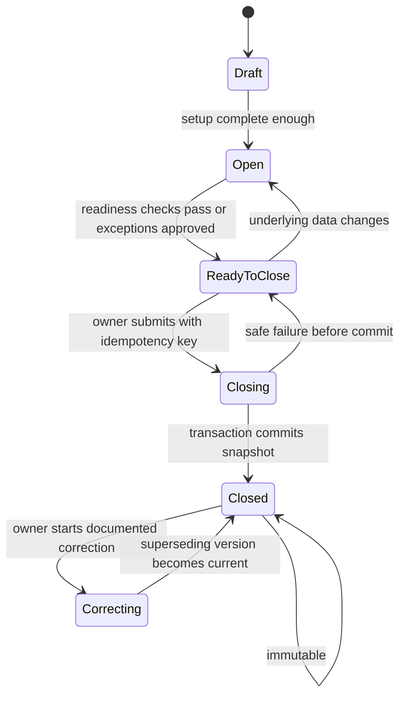

# Month Close and Snapshot Design

> **Classification:** Internal  
> **Authority:** Closed-period integrity authority  
> **Audience:** Founder and Cursor  
> **Status:** Founding MVP baseline  
> **Last reviewed:** 2026-07-16


## 1. Purpose

Month close converts changing operational data into a permanent, explainable household record. It is not simply a status toggle or PDF button. Close must prove that the chosen data was sufficiently complete, capture documented exceptions, calculate canonical results exactly once for that version, and preserve evidence even when live data later changes.

## 2. Period states



- **Draft:** period exists but setup may be incomplete.
- **Open:** financial records can change.
- **Ready to close:** current validation passed at a point in time. It must be rechecked during close.
- **Closing:** optional transient/job state; do not leave unrecoverable locks.
- **Closed:** one complete immutable snapshot version is current.
- **Correcting:** UI workflow that prepares a superseding version; original snapshot remains closed.

## 3. Reconciliation requirements

Default close rules:

- every active balance-bearing account marked “requires reconciliation” has a completed session for the period;
- session statement date is within allowed period/end tolerance;
- difference is zero, or an owner-approved exception includes reason and amount;
- no imported batch remains partially committed or unresolved;
- no transaction is in an invalid split/transfer state;
- required manual valuations have an acceptable as-of date;
- required budget/meeting sections are complete;
- no unsupported currency mix exists.

The exact list is versioned. Close UI shows blockers and warnings separately.

## 4. Approved exceptions

An exception is explicit data:

```text
kind, affected account/requirement, amount if relevant,
reason, approved_by, approved_at, period, snapshot_version
```

Exceptions are visible in the close confirmation and generated report. They do not silently change a failed check into success. Some conditions—cross-household mismatch, invalid split sum, unsupported currency, authorization failure—are never overridable.

## 5. Close readiness

Provide a read model:

```ts
export type CloseReadiness = {
  periodId: string;
  version: string;
  blockers: readonly CloseIssue[];
  warnings: readonly CloseIssue[];
  reconciliation: readonly AccountReadiness[];
  meetingComplete: boolean;
  dataFreshness: readonly FreshnessStatus[];
  computedAt: string;
};
```

Readiness is advisory until close. The close transaction re-evaluates authoritative predicates to prevent time-of-check/time-of-use races.

## 6. Transaction boundary

The database transaction should:

1. acquire an advisory or row lock for household + period;
2. verify authenticated actor and owner permission through the trusted call path;
3. reject/replay an existing idempotency key safely;
4. lock/re-read period and relevant version counters;
5. re-run non-overridable readiness checks and validate approved exceptions;
6. select canonical source rows at the transaction snapshot/isolation level;
7. compute or receive validated deterministic calculation inputs;
8. insert `financial_snapshots` in building state;
9. insert copied account, budget and meeting/exception details;
10. compute/store aggregate values, rule version and content hash;
11. mark snapshot complete/current and period closed;
12. carry incomplete action items once;
13. create next period shell according to copy-forward rules;
14. create pending generated-report record;
15. write audit events;
16. commit.

PDF rendering and email happen after commit. A PDF outage must not corrupt financial truth.

## 7. Snapshot contents

### Header

Household identifier/name copy, snapshot type, period, household timezone, currency, version, supersedes link, calculation rule version, close actor/time, completeness and exception summaries, content hash.

### Financial values

- account names/types/inclusion and exact balances/valuations as used;
- reconciliation status/freshness per account;
- net worth assets/liabilities totals;
- income, expense, cash-flow and uncategorized totals;
- budget planned/actual/variance lines;
- debt balances/progress and estimate assumptions;
- savings goals/progress;
- investment balances/contributions;
- selected dashboard KPIs and transparent health-score components;
- meeting notes, decisions, goals and action-item state needed for the report.

Do not rely solely on live foreign keys for labels because categories/accounts may later be renamed or archived. Copy report-relevant display values into snapshot detail rows.

## 8. Immutability

After status `complete`:

- no normal update/delete grants or RLS policies;
- trigger/function guard rejects mutation;
- reports reference snapshot ID/version;
- correction creates a new snapshot that `supersedes_id` the prior current version;
- old reports are retained and labelled superseded according to retention policy;
- history UI identifies current and prior versions.

## 9. Idempotency and duplicate prevention

Client generates an opaque idempotency key for the close intent. Database uniqueness can use `(household_id, period_id, idempotency_key)`. A retry returns the existing outcome. Independently enforce only one current complete version per period with a partial unique index or serialized function.

Duplicate prevention must handle:

- double-click;
- browser retry after network timeout;
- server retry after response loss;
- concurrent household members;
- report worker retry;
- correction version races.

## 10. Reopening/correction policy

Recommended MVP policy: **never reopen in place**. An owner selects “Correct and re-close,” enters a reason, and creates a controlled correction workspace based on the prior period. The eventual close creates version N+1. The audit trail and UI show both. This is more work than a mutable reopen but protects trust and supportability.

## 11. Action-item carryover

On close, each incomplete action may produce one new action linked by `carried_from_id` to the next period. Use a uniqueness rule to prevent retry duplicates. Preserve original title/owner/due date plus indicate carryover; do not silently change overdue dates.

## 12. PDF generation

- Durable report record starts `pending` in the close transaction.
- Worker/endpoint claims with a lease or compare-and-set status.
- Print route requires internal job authorization and loads only snapshot data.
- Playwright renders print CSS, embeds approved fonts/assets, and produces a deterministic-enough PDF.
- Store private object, SHA-256 hash, byte size and template version.
- Mark ready and notify user; retries are bounded.
- A correction generates a new report; old report is marked superseded, not overwritten.

## 13. Quarterly aggregation

Quarterly review reads the current eligible versions of three monthly snapshots, never live transactions. It records the exact source snapshot IDs. Corrections after quarter close require a superseding quarterly version or a visible “source month corrected” status; do not silently recompute a closed quarter.

## 14. Audit events

Minimum events:

- close requested, blocked and failed with safe reason code;
- exception approved/revoked;
- snapshot committed;
- report generation ready/failed;
- correction started/cancelled/committed;
- snapshot/report superseded;
- quarterly snapshot committed.

No audit metadata contains notes, descriptions or full financial values unless a narrowly defined integrity need is approved.

## 15. Failure recovery

| Failure point | Expected outcome | Recovery |
|---|---|---|
| Validation before transaction | No change | Fix blocker and retry |
| Exception approval race | No close | Refresh readiness |
| Database error before commit | Full rollback | Retry same idempotency key after diagnosis |
| Response lost after commit | Snapshot exists | Retry returns existing result |
| Report renderer fails | Month remains closed, report failed | Retry report record |
| Storage succeeds, DB update fails | Orphan private object possible | Reconciliation job deletes or attaches by hash/key |
| Next-period creation conflict | Close transaction rolls back unless designed as safely idempotent | Fix invariant and retry |
| Correction concurrent close | One version wins lock/unique constraint | Refresh and review current version |

## 16. Required tests

### Unit

- every calculation and rounding boundary;
- readiness issue classification;
- carryover transformation;
- report view model from snapshot.

### Database/integration

- transaction rollback on injected failure at each stage;
- lock and duplicate close race;
- idempotent retry;
- immutable update/delete rejection;
- cross-household source rejection;
- version/supersedes constraints;
- action carryover uniqueness.

### End-to-end

- reconcile → meet → close → report → next period;
- close blocked with clear action;
- owner exception and visible report disclosure;
- editor cannot close/correct under default matrix;
- correction produces version 2 without changing version 1;
- report download authorization and expired link.

## 17. Example closing sequence

```ts
const result = await closeMonth({
  actorUserId: auth.userId,
  householdId: params.householdId,
  periodId: params.periodId,
  idempotencyKey: parsed.data.idempotencyKey,
  expectedReadinessVersion: parsed.data.readinessVersion
});

// result is either the existing successful close for this key
// or a newly committed snapshot. PDF status is separate.
```

The application service should be thin enough that the transactional invariant remains centralized and testable, but explicit enough that the founder can understand each step.
