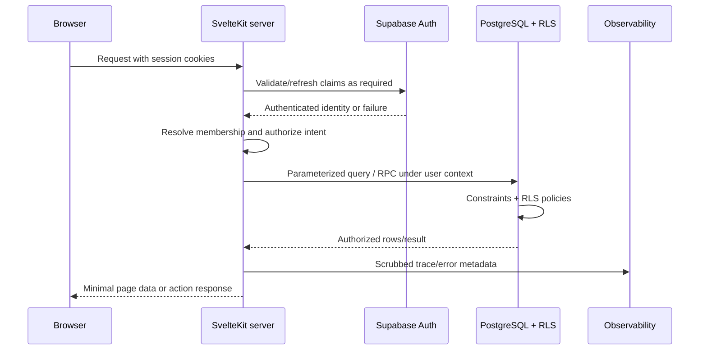
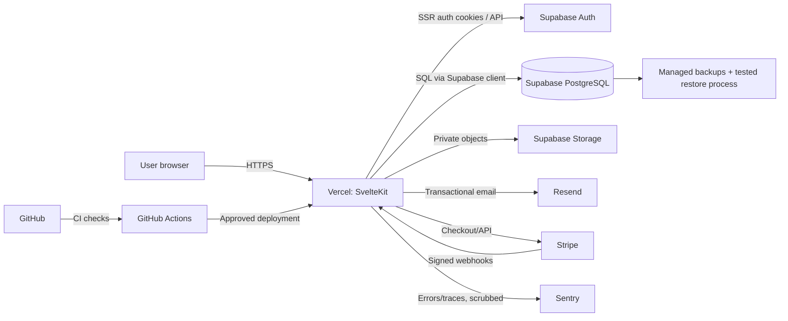
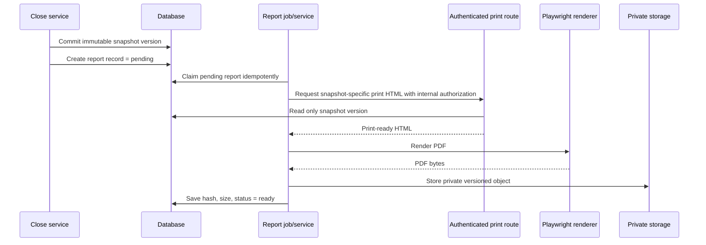

# System Architecture

> **Classification:** Internal  
> **Authority:** Architecture authority  
> **Audience:** Founder and Cursor  
> **Status:** Founding MVP baseline  
> **Last reviewed:** 2026-07-16


## 1. Architectural decision

Build Isuna as a **modular SvelteKit monolith** deployed as one web application, backed by one Supabase PostgreSQL project per environment. A modular monolith means the application is deployed together but internally organized into domains with clear interfaces. This gives a solo developer one repository, one release path and straightforward database transactions while preventing route files and UI components from becoming the business layer.

For a developer coming from ASP.NET Web Forms or MVC:

- Svelte components are comparable to strongly focused view components, not code-behind pages.
- `+page.server.ts` and `+server.ts` are server entry points, comparable to controller/action boundaries.
- `hooks.server.ts` is an application-wide request pipeline, comparable to middleware or global filters.
- `event.locals` is request-scoped context, comparable to `HttpContext.Items` or scoped services.
- `$lib/server/*` is server-only application/domain infrastructure; importing it into browser code should fail the build.
- PostgreSQL RLS is an additional database authorization layer, not a replacement for server authorization.

## 2. Recommended stack and why it fits

| Layer | Choice | Why it fits Isuna and a solo developer |
|---|---|---|
| Full-stack framework | SvelteKit + Svelte 5 + TypeScript | One codebase for SSR, forms, endpoints and UI; typed boundaries; low client overhead; official routing and server conventions are teachable in small steps. |
| Styling | Tailwind CSS + Isuna tokens | Fast iteration without a runtime styling system; a documented token layer prevents arbitrary utility combinations from becoming the design system. |
| Accessible primitives | Bits UI | Headless Svelte 5 primitives provide keyboard/ARIA foundations while Isuna owns visual styling. Native HTML remains preferred where sufficient. |
| Validation | Zod | Shared schemas can describe input shape, while server code still performs authorization and database checks. |
| Data/Auth/Storage | Supabase | Managed PostgreSQL, Auth, Storage, migrations and RLS reduce infrastructure breadth while preserving SQL control. |
| Hosting | Vercel | Natural SvelteKit deployment, branch previews and environment separation. Verify runtime limits for PDF generation and long jobs. |
| Payments | Stripe Checkout/Billing | Hosted payment collection reduces payment-card scope; server webhooks remain authoritative. |
| Email | Resend | Focused transactional API and domain verification; wrap behind an interface. |
| Monitoring | Sentry | Error and performance monitoring with SvelteKit integration; scrub sensitive data aggressively. |
| Tests | Vitest + Playwright | Fast deterministic domain tests plus browser-level workflow and accessibility checks. |
| PDFs | Authenticated print routes + Playwright | HTML/CSS remains the report template; PDF is rendered from an immutable snapshot-specific route. |

### Cost-control principles

- Stay on managed entry tiers during development; set usage alerts before beta.
- Avoid always-on workers until a durable job is demonstrably needed.
- Store only required originals and reports; define retention.
- Use one application and one database per environment, not per household.
- Instrument expensive queries/import sizes before optimizing infrastructure.
- Treat vendor free tiers as temporary pricing, not architecture guarantees.

## 3. Module boundaries

Recommended domains:

```text
identity          profiles, auth context
households        household settings, membership, invitations
onboarding        setup state and next steps
ledger            accounts, transactions, splits, transfers, categories, imports
budgeting         periods, items, actual aggregation, templates
reconciliation    statement sessions, items, exceptions, readiness
planning          debts, savings goals, investments, FI scenarios
reporting         net worth, dashboard read models, meetings, quarterly reviews
closing           close orchestration, snapshot versions, correction workflow
files             private storage, reports, export archives
billing           Stripe customer/subscription/entitlements
notifications     email and preference orchestration
audit             protected event writing and review
```

A module may expose typed application services and read models. Route code should call these services rather than assembling multi-table business operations directly.

## 4. Server/client boundary

### Browser responsibilities

- render UI and local interaction state;
- submit forms and request authorized data;
- perform convenience validation that is repeated on the server;
- display progress and errors;
- never decide household ownership, role, entitlement, close eligibility or final calculations.

### Server responsibilities

- verify authenticated claims/session;
- resolve permitted household membership;
- parse and validate untrusted input;
- authorize the operation;
- call domain/application services;
- execute database operations and transactions;
- return the minimum required response;
- emit safe audit/monitoring signals.

### Database responsibilities

- authoritative persistent state;
- foreign keys, unique constraints, checks and transaction atomicity;
- RLS tenant isolation and least privilege;
- immutable snapshot protection;
- selected deterministic SQL aggregation where it improves correctness;
- migration history.

## 5. Request flow



## 6. High-level deployment diagram



## 7. Authentication flow

1. Browser starts email/password or OAuth flow.
2. Supabase Auth establishes a session; SSR integration stores session material in secure cookies according to current official guidance.
3. `hooks.server.ts` constructs a request-scoped server client and exposes verified identity/claims through `event.locals`.
4. Protected route groups require identity before loading application data.
5. Feature services resolve household membership from the authenticated user and requested resource. The browser-provided household selector is only a candidate context.
6. PostgreSQL RLS independently rejects rows outside authorized membership.
7. Sign-out clears the session and sensitive pages use appropriate cache headers.

Do not build authorization from unverified JWT decoding in application code. Follow the current Supabase SSR guidance at implementation time because authentication SDK details evolve.

## 8. File-storage flow

Private buckets:

- `imports` — optional retained source CSVs, short retention;
- `reports` — versioned monthly/quarterly PDFs;
- `exports` — encrypted/private household export archives, short-lived;
- future `attachments` only after explicit scope approval.

Object keys begin with an opaque household identifier and record identifier, but path shape is not authorization. Access is checked by storage policy and a server-side membership check. Downloads use short-lived signed URLs or server streaming. Never place reports in public buckets.

## 9. PDF generation flow



PDF failure must not roll back an otherwise valid close. The durable report record can be retried safely. A report never queries live accounts after snapshot selection.

## 10. Email flow

Route/application service creates a typed email command, checks preference and purpose, renders a versioned template, calls an `EmailProvider`, and records delivery metadata without storing full sensitive content. Invitations include an opaque single-use token, not financial details. Provider webhooks are verified if delivery events are consumed.

```ts
export interface EmailProvider {
  send(message: TransactionalEmail): Promise<{ providerMessageId: string }>;
}
```

## 11. Stripe flow

- Create Checkout or Customer Portal sessions only on the server for an authorized household owner.
- Use Stripe-hosted payment UI; never collect raw card data in Isuna forms.
- Verify webhook signatures against the raw request body.
- Store event IDs and process idempotently.
- Map Stripe customer/subscription state to a server-side entitlement record.
- Treat browser redirects as presentation only; they do not prove payment.
- Separate test and live credentials and webhook secrets by environment.

## 12. Environment separation

Use separate Supabase projects, storage buckets, OAuth applications where practical, Stripe modes/configuration, email sender identities and Sentry environments for:

- local development;
- automated test/ephemeral database;
- preview or staging;
- production.

Never point preview deployments at production data. Environment variables are configured per deployment environment; `.env.example` contains names only. Production migrations run through a controlled pipeline with an explicit backup/rollback assessment.

## 13. Logging and monitoring

Log structured operational metadata: timestamp, environment, request/correlation ID, route/action name, status, duration, user/household opaque IDs only when necessary, and error class. Do not log transaction descriptions, account names, CSV rows, notes, report bodies, tokens, cookies, passwords or provider secrets.

Monitoring baseline:

- error-rate and latency alerts;
- authentication/invitation abuse signals;
- failed/lagging Stripe webhook processing;
- month-close/report failures;
- export/deletion job failures;
- database connection/storage usage thresholds;
- backup status and restore-test evidence.

## 14. Provider interfaces

Wrap providers where replacement, testing or policy boundaries matter:

```ts
export interface PdfRenderer {
  render(input: { url: URL; correlationId: string }): Promise<Uint8Array>;
}

export interface BillingProvider {
  createCheckout(input: CheckoutRequest): Promise<{ url: string }>;
  verifyWebhook(rawBody: Uint8Array, signature: string): BillingEvent;
}

export interface ObjectStore {
  putPrivate(input: PrivateObjectWrite): Promise<StoredObject>;
  createAuthorizedDownload(input: DownloadRequest): Promise<URL>;
}
```

Do not abstract PostgreSQL behind a generic repository for every table. Domain-specific query functions are clearer and preserve SQL strengths.

## 15. Scaling approach

### Phase 1: MVP

One SvelteKit app, one PostgreSQL database, synchronous request flows for normal CRUD, bounded imports, durable records for reports/exports, database indexes based on query plans.

### Phase 2: observed pressure

Add a dedicated job runner only for demonstrated long-running work; use connection pooling; add read-model/materialized-view strategies for expensive dashboards; archive old import artefacts; partition only tables with measured need.

### Phase 3: exceptional scale

Split a service only when it has a distinct scaling, security, ownership or availability requirement. Preserve database consistency contracts and avoid distributed transactions around month close.

## 16. Architectural invariants

1. The authenticated user is never equivalent to a household ID.
2. Every household-owned row has an unambiguous household ownership path.
3. Every exposed household table has RLS and tests.
4. Monetary amount and currency travel together.
5. Closed snapshots are append-only/versioned.
6. Cross-record financial changes are transactional.
7. Reports identify exact snapshot and rule versions.
8. The same calculation implementation powers UI, close and reports where possible.
9. External provider events are verified and idempotent.
10. No UI convenience bypasses server validation or authorization.

## 17. Official implementation references

Review current official documentation when implementing, especially because framework details may change:

- SvelteKit introduction, hooks, server load and form actions: `https://svelte.dev/docs/kit`
- Supabase SSR Auth and RLS: `https://supabase.com/docs/guides/auth/server-side` and `https://supabase.com/docs/guides/database/postgres/row-level-security`
- Bits UI: `https://bits-ui.com/docs`
- Vercel SvelteKit and environment docs: `https://vercel.com/docs/frameworks/full-stack/sveltekit`
- Stripe Checkout/Billing/webhooks: `https://docs.stripe.com/webhooks`
- Playwright PDF and accessibility testing: `https://playwright.dev/docs/api/class-page` and `https://playwright.dev/docs/accessibility-testing`
- Sentry SvelteKit: `https://docs.sentry.io/platforms/javascript/guides/sveltekit/`
