# MVP Roadmap and Sprints

> **Classification:** Internal  
> **Authority:** Delivery sequence authority  
> **Audience:** Founder and Cursor  
> **Status:** Founding MVP baseline  
> **Last reviewed:** 2026-07-21

## Planning assumptions

This roadmap uses **twelve two-week planning sprints** to make sequence and scope explicit. It is not a promise of a 24-week launch. The founder is learning Svelte/SvelteKit, TypeScript, Supabase, RLS and modern testing while personally writing and understanding the code. Some planning sprints may require multiple calendar sprints; security, debugging and user research can extend them. Do not compress by handing whole features to Cursor.

### Estimation rule

A sprint ends on evidence and exit criteria, not the calendar. Carry over the smallest incomplete slice; do not start broad new scope while tenant isolation, data integrity or tests are unresolved.

## Milestone map

| Milestone | Planned sprints | Product proof gained |
|---|---:|---|
| 0 Foundation | 1 | Reproducible, testable learning environment |
| 1 Auth/households | 2–3 | Secure collaborative tenant |
| 2 Onboarding/accounts | 4 | Initial household picture |
| 3 Transactions/imports | 5–6 | Maintainable monthly ledger |
| 4 Budget/reconciliation | 7 | Trustworthy plan and statement alignment |
| 5 Debt/savings/investments | 8 | Complete manual financial picture |
| 6 Net worth/dashboard | 9 | Current position and attention |
| 7 Monthly meeting | 10 | Structured decisions and actions |
| 8 Close/quarterly | 11 | Immutable history and reports |
| 9 SaaS/launch | 12 | User control and operational readiness |

## Sprint 1: Foundation and learning baseline

**Milestone:** Milestone 0: Foundation

- **Objective:** Create a reproducible repository, development environment, documentation placement, SvelteKit shell, local Supabase stack, design tokens and CI skeleton without implementing product features.
- **User outcome:** The founder can clone the repository, run the app and database locally, execute baseline checks, and explain the server/browser structure.
- **Learning objectives:** SvelteKit file routing; Svelte 5 component basics; TypeScript strictness; pnpm/Node; Supabase CLI/local stack; environment separation; GitHub Actions.
- **Scope:** Repository/branch protection; `npx sv create`; Tailwind; Bits UI evaluation spike; local Supabase; first migration placeholder only for extensions; Vitest/Playwright; app shell; design tokens; lint/type/build CI; docs copied under `docs/`.
- **Prerequisites:** OD-03 stack-currency policy Approved (latest stable selection; Node = production LTS recommendation); OD-02 component default confirmed or still provisional; GitHub, Vercel and Supabase development accounts.
- **Stories:** Engineering enablers; no end-user financial story is considered delivered.
- **Technical tasks:** Pin runtime; configure aliases and strict TS; create route groups; add `$lib/server` boundary; local env validation; CI workflow; preview deployment connected to non-production environment; README setup instructions.
- **Security tasks:** Secret scanning; `.gitignore`; no production credentials; CI least permissions; environment matrix; secure headers backlog identified.
- **Tests:** Sample pure unit test; Playwright smoke page; clean migration apply; production build; forbidden private-env browser import test.
- **Documentation:** Repository standards, setup README, open decisions updated with exact Node/pnpm/package versions recorded after scaffold (OD-03 policy already Approved).
- **Demo:** Fresh clone to running local app; unit/E2E/build/CI pass; show no secrets and route/server structure.
- **Acceptance criteria:** Another developer could follow README; founder explains each tool; `main` protected; CI runs; local DB resets reproducibly.
- **Out of scope:** Auth, real tables, provider integrations, visual polish beyond foundations.
- **Exit criteria:** One tagged foundation baseline and a reviewed Sprint 2 task list.

### Suggested checkpoints

1. Schema/architecture and learning checkpoint.
2. Small happy-path vertical slice.
3. Failure, permission and accessibility states.
4. Automated tests and founder code review.
5. Demo, documentation and sprint exit review.
## Sprint 2: Authentication and profile foundation

**Milestone:** Milestone 1: Authentication and households

- **Objective:** Implement verified identity, SSR-compatible sessions, profile creation and protected app routes.
- **User outcome:** A user can register, verify, sign in, recover access, sign out and reach a protected empty application area at `/app`.
- **Learning objectives:** Supabase Auth SSR cookies/claims; SvelteKit hooks and locals; form actions; OAuth callback; expected error handling.
- **Scope:** Browser/server Supabase clients; hooks; app.d.ts; email/password; verification callback; reset/update password; Google OAuth; profile table/RLS/trigger; auth layouts/pages; generic errors; empty `/app` shell.
- **Prerequisites:** Sprint 1; Supabase redirect URLs; test email path; current official SSR docs reviewed; **Checkpoint 1 approved 2026-07-21** (see open-decisions / OD-19).
- **Approved architecture (Checkpoint 1):** `getAuthContext()` via `getClaims()`; profile `user_id` + Auth insert trigger + idempotent ensure; own-user RLS only; defaults `en-CA` / `America/Edmonton`; `/app` shell; email must be verified before `(app)` (OD-19). OD-10 roles remain provisional until Sprint 3.
- **Stories:** Authentication US-001–004 and own-profile behaviour.
- **Technical tasks:** Small migrations; generated types; auth schemas; server actions; protected layout; account menu; session expiry handling.
- **Security tasks:** No token logs; generic recovery; safe local redirects; own-profile RLS; verification gate; cache review; rate/provider settings; service role absent.
- **Tests:** Schema/unit; database own/other profile RLS; Playwright register/sign-in/sign-out/reset strategy; expired session/direct protected route; unverified blocked from `/app`.
- **Documentation:** Auth implementation notes, environment variables, current SDK/version decisions; Checkpoint 1 recorded in open-decisions.
- **Demo:** Create/verify user, protected redirect to `/app`, sign out, failed recovery response, inspect sanitized error.
- **Acceptance criteria:** All auth acceptance criteria pass; no protected page data after sign-out; profile created exactly once; unverified cannot access `/app`.
- **Out of scope:** Household membership and invitations.
- **Exit criteria:** Verified auth context is a stable request-scoped contract used by later services.

### Suggested checkpoints

1. Schema/architecture and learning checkpoint — **complete (approved 2026-07-21).**
2. Small happy-path vertical slice.
3. Failure, permission and accessibility states.
4. Automated tests and founder code review.
5. Demo, documentation and sprint exit review.
## Sprint 3: Households, roles and invitations

**Milestone:** Milestone 1: Authentication and households

- **Objective:** Create secure multi-tenant workspaces with owner/editor roles, switching and invitation lifecycle.
- **User outcome:** An owner creates a household, invites a partner, the partner joins as Editor, and each sees only authorized households.
- **Learning objectives:** Shared-schema multitenancy; PostgreSQL RLS; composite ownership; transactions/RPC; token hashing and concurrency.
- **Scope:** Households/members/invitations; owner creation transaction; switcher; profile; invite email provider fake then Resend test; accept/revoke/expiry; remove member; permission helpers.
- **Prerequisites:** Stable auth context; email domain/test config; role/open-decision defaults.
- **Stories:** Household and invitation stories US-005 onward in corresponding modules.
- **Technical tasks:** Migrations and RLS; server services/actions; household routes/settings; single-use hashed token; audit baseline; email abstraction.
- **Security tasks:** Owner/editor matrix; last-owner invariant; invitation abuse/rate; cross-household CRUD suite; security-definer review; no household details before acceptance.
- **Tests:** RLS matrix; concurrent accept; duplicate household submit; removed member; direct foreign route; email template unit.
- **Documentation:** Permission matrix confirmed; threat model and DB model updated for implementation details.
- **Demo:** Two browsers/users create/join/switch; Editor denied owner actions; Household B direct ID fails.
- **Acceptance criteria:** Tenant isolation tests cover all current tables; membership removal takes effect immediately.
- **Out of scope:** Financial records, advanced org roles, MFA.
- **Exit criteria:** A reusable `requireHouseholdRole`/permission approach is proven without service-role CRUD.

### Suggested checkpoints

1. Schema/architecture and learning checkpoint.
2. Small happy-path vertical slice.
3. Failure, permission and accessibility states.
4. Automated tests and founder code review.
5. Demo, documentation and sprint exit review.
## Sprint 4: Guided onboarding, accounts and categories

**Milestone:** Milestone 2: Onboarding and accounts

- **Objective:** Let a household establish locale, setup progress, account inventory, opening values and categories.
- **User outcome:** A household can create its initial financial structure and clearly see what remains before a first month.
- **Learning objectives:** Progressive forms; money parsing to bigint; date/timezone boundaries; category hierarchy; archive versus delete.
- **Scope:** Onboarding state/read model; country/province/currency; accounts/account valuations; seeded categories; add/edit/archive; net-worth inclusion; opening balances; responsive setup UI.
- **Prerequisites:** Household isolation; money/currency design approved; category seed strategy.
- **Stories:** Onboarding and accounts/categories stories.
- **Technical tasks:** Migrations, composite FKs, RLS; money input/formatter; server actions/query modules; setup progress derivation; synthetic seeds.
- **Security tasks:** Ownership consistency; bounds/overflow; editor/owner permissions; no hard delete of dependencies; custom-name log scrubbing.
- **Tests:** Money parser; table constraints; RLS; archive/restore; setup progress under concurrent member update; keyboard/mobile forms.
- **Documentation:** Actual account taxonomy and seed version; design component decisions.
- **Demo:** Create Canadian household accounts, opening values and categories; archive one; resume onboarding.
- **Acceptance criteria:** All values preserve exact cents; foreign account/category references rejected; setup progress derives from data.
- **Out of scope:** Transactions, current balance from ledger, multi-currency aggregation.
- **Exit criteria:** Account/category APIs are stable inputs for ledger work.

### Suggested checkpoints

1. Schema/architecture and learning checkpoint.
2. Small happy-path vertical slice.
3. Failure, permission and accessibility states.
4. Automated tests and founder code review.
5. Demo, documentation and sprint exit review.
## Sprint 5: Manual ledger and transaction review

**Milestone:** Milestone 3: Transactions and imports

- **Objective:** Create a reliable manual transaction ledger with review, clear status, category allocation and search.
- **User outcome:** Users can enter and investigate monthly activity and see which rows still need attention.
- **Learning objectives:** Signed money convention; pagination/filtering; transactional split invariant; progressive enhanced forms.
- **Scope:** Transactions and one/default split; manual create/edit; search/filter/pagination; review/cleared; notes; reverse/archive policy; transaction detail; ledger balance query.
- **Prerequisites:** Accounts/categories; period/date convention; closed-period guard design.
- **Stories:** Manual transaction, split foundation and search stories.
- **Technical tasks:** Migrations/indexes/RLS; query read models; validation; transaction list/table/mobile cards; balance derivation; audit only where required.
- **Security tasks:** Direct foreign account/category; XSS in description/note; bounded search; no sensitive logs; closed-date mutation placeholder enforced once periods exist.
- **Tests:** Money/sign fixtures; split sum; RLS; filters; duplicate action retry; XSS rendering; E2E manual transaction.
- **Documentation:** Ledger sign convention and mutation policy finalized.
- **Demo:** Enter income/expense/refund, categorize, review, search, show exact account balance and foreign-ID denial.
- **Acceptance criteria:** Ledger and splits remain consistent transactionally; list performance acceptable on representative data.
- **Out of scope:** CSV, transfer pairs, advanced rules, bank sync.
- **Exit criteria:** Manual data path is sufficient to continue the full MVP even if import slips.

### Suggested checkpoints

1. Schema/architecture and learning checkpoint.
2. Small happy-path vertical slice.
3. Failure, permission and accessibility states.
4. Automated tests and founder code review.
5. Demo, documentation and sprint exit review.
## Sprint 6: CSV imports, transfers and categorization rules

**Milestone:** Milestone 3: Transactions and imports

- **Objective:** Reduce monthly entry effort without sacrificing preview, validation, duplicate control or ledger integrity.
- **User outcome:** A user maps a generic bank CSV, previews issues, commits valid rows once, resolves transfers and reuses simple category rules.
- **Learning objectives:** Untrusted file parsing; streaming/limits; idempotency; import staging; duplicate heuristics; transfer accounting.
- **Scope:** Import/upload records as implementation-needed tables; mapping; preview; validation; commit batches; per-row results; duplicate candidates; saved mappings Could-have; transfers; splits completion; simple normalized rules.
- **Prerequisites:** Stable manual ledger; retention decision; sample synthetic CSVs.
- **Stories:** CSV import, transfer and categorization-rule acceptance.
- **Technical tasks:** Parser adapter; import fingerprint; private/transient storage decision; import UI; transfer group operation; rule proposal engine.
- **Security tasks:** File/row/field limits; formula/data injection; parser timeout; no raw rows in logs; RLS on staged rows/storage; commit re-authorizes account.
- **Tests:** Malformed/fuzz fixtures; duplicate retry; partial rollback; foreign import ID; transfer cash-flow exclusion; rule priority.
- **Documentation:** Supported template/mapping behaviour, retention and export neutralization rules.
- **Demo:** Preview invalid CSV, correct mapping, commit once, retry safely, mark transfer, apply/override rule.
- **Acceptance criteria:** No commit occurs before explicit approval; retries do not duplicate; imported values reconcile to preview totals.
- **Out of scope:** Institution-specific scraping, OCR, direct sync.
- **Exit criteria:** A representative household can load a month in reasonable manual effort.

### Suggested checkpoints

1. Schema/architecture and learning checkpoint.
2. Small happy-path vertical slice.
3. Failure, permission and accessibility states.
4. Automated tests and founder code review.
5. Demo, documentation and sprint exit review.
## Sprint 7: Budgeting and reconciliation

**Milestone:** Milestone 4: Budgeting and reconciliation

- **Objective:** Build the data-quality core for planned-versus-actual review and statement reconciliation.
- **User outcome:** A household creates a monthly plan, understands variance, reconciles accounts and sees close blockers.
- **Learning objectives:** Period models; actual aggregation; transfer/category semantics; reconciliation accounting; readiness read models.
- **Scope:** Budgets/templates; periods/items; copy previous; actual/variance; reconciliation sessions/items; statement/application/difference; approved exception; close-readiness v1.
- **Prerequisites:** Ledger/imports; calculation definitions; owner exception decision.
- **Stories:** Budget and reconciliation stories.
- **Technical tasks:** Migrations/RLS; actual SQL/query service; period selector; budget editor; reconciliation workflow; readiness issue codes; concurrent ledger invalidation.
- **Security tasks:** Closed/open status authorization; owner exception; foreign account/period; no client-computed authoritative difference; exception audit.
- **Tests:** Variance rules; actual aggregation/refunds/transfers; RLS; late transaction changes status; exception; E2E budget→reconcile.
- **Documentation:** Close blocker/warning version; budget actual basis; reconciliation tolerance policy.
- **Demo:** Copy budget, enter transactions, inspect variance, reconcile exact and exception account, see readiness.
- **Acceptance criteria:** Actual totals trace to rows; reconciliation difference is deterministic; readiness changes after source edits.
- **Out of scope:** Close commit, snapshot, report.
- **Exit criteria:** A month can be declared ready based on reliable checks.

### Suggested checkpoints

1. Schema/architecture and learning checkpoint.
2. Small happy-path vertical slice.
3. Failure, permission and accessibility states.
4. Automated tests and founder code review.
5. Demo, documentation and sprint exit review.
## Sprint 8: Debt, savings and investments

**Milestone:** Milestone 5: Debt, savings, and investments

- **Objective:** Complete the manual household balance-sheet and goal picture at MVP depth.
- **User outcome:** Users track debts, goals and investments, understand transparent progress and see scenario limitations.
- **Learning objectives:** Decimal rates; amortization loops; contribution versus valuation; transparent projections and disclaimers.
- **Scope:** Debts/payments; snowball/avalanche/custom; payoff estimate; savings goals/contributions/emergency months; investment specialization/contributions/valuations; basic FI inputs if quality allows.
- **Prerequisites:** Accounts/transactions; calculation strategy/library decision; disclaimer wording.
- **Stories:** Debt, savings and investment stories.
- **Technical tasks:** Migrations/RLS; domain calculations; fixtures; forms/tables/progress; as-of/freshness; account linkage.
- **Security tasks:** Bounds; no advice claims; custom names/notes scrubbed; same-household linkage; closed edits prohibited.
- **Tests:** All canonical calculation edge cases; lender-style independent fixtures; RLS; contribution transfer exclusion; accessibility.
- **Documentation:** Calculation rule versions, assumptions and visible disclaimers finalized.
- **Demo:** Compare strategies, non-amortizing warning, goal progress/emergency months, manual investment valuation, FI scenario disclaimer.
- **Acceptance criteria:** No estimate displays without valid assumptions/completeness; exact money and decimal-safe rates used.
- **Out of scope:** Market prices, personalized recommendations, advanced scenario engine.
- **Exit criteria:** All current-position domains have stable source data.

### Suggested checkpoints

1. Schema/architecture and learning checkpoint.
2. Small happy-path vertical slice.
3. Failure, permission and accessibility states.
4. Automated tests and founder code review.
5. Demo, documentation and sprint exit review.
## Sprint 9: Net worth, executive dashboard and next actions

**Milestone:** Milestone 6: Net worth and dashboard

- **Objective:** Turn trusted current data into a calm decision-oriented summary.
- **User outcome:** A member sees the whole position, freshness and the few actions that matter next.
- **Learning objectives:** Read models; efficient aggregate queries; data completeness; accessible charts; rule-versioned health score.
- **Scope:** Net worth current/as-of; cash flow; debt/savings/investing KPIs; dashboard 3–8 KPIs; one/two charts; unreconciled/freshness; upcoming bills/expenses; next-action derivation; health score if ready.
- **Prerequisites:** All source modules; calculation rules; recurring bills Should-have may be minimal.
- **Stories:** Dashboard/net worth stories.
- **Technical tasks:** Dashboard query/service; component inventory; chart wrapper and text summary; period comparison; caching policy; query plans.
- **Security tasks:** Household-scoped aggregates; no raw amounts in analytics; no stale zero; report/closed distinction; performance abuse bounds.
- **Tests:** Calculation/read-model unit; DB aggregate; RLS; query plan; dashboard E2E partial/complete; axe/keyboard/mobile.
- **Documentation:** KPI definitions and score version; design refinements from real page.
- **Demo:** Show partial onboarding, current complete, previous comparison and action link to reconcile/detail.
- **Acceptance criteria:** Every KPI links to source and states freshness/completeness; dashboard remains understandable on mobile.
- **Out of scope:** Custom dashboards, many charts, predictive insights.
- **Exit criteria:** The product answers where we stand and what needs attention.

### Suggested checkpoints

1. Schema/architecture and learning checkpoint.
2. Small happy-path vertical slice.
3. Failure, permission and accessibility states.
4. Automated tests and founder code review.
5. Demo, documentation and sprint exit review.
## Sprint 10: Monthly Money Meeting

**Milestone:** Milestone 7: Monthly Money Meeting

- **Objective:** Create the guided household review, decisions and action-item workflow.
- **User outcome:** A household completes a calm structured meeting using current data and leaves with decisions, owners and next goals.
- **Learning objectives:** Long-form resumable workflow; concurrent edits; structured notes; attribution; accessible step navigation.
- **Scope:** Meeting state/sections; scorecard source cards; wins/challenges; bills/expenses; decisions; action items; next goals; close checklist; save progress; attribution; carryover preview.
- **Prerequisites:** Dashboard/readiness; notes/action schema; meeting content/copy approved.
- **Stories:** Monthly meeting and action-item stories.
- **Technical tasks:** Migrations/RLS; meeting service; section routes or one route with stable navigation; autosave/manual-save decision; conflict handling; action components.
- **Security tasks:** Notes are sensitive; no telemetry/logging; member attribution; XSS escaping; assignee membership; closed guard.
- **Tests:** Section completion; concurrent edit strategy; removed assignee; RLS; refresh/resume; keyboard/screen reader; full E2E meeting.
- **Documentation:** Meeting completion rules and copy; privacy/data inventory.
- **Demo:** Two members review sections, record decision/action, refresh/resume, reach close checklist.
- **Acceptance criteria:** Meeting can complete without losing entries; source numbers trace to dashboard; action ownership is clear.
- **Out of scope:** Chat, video, AI coaching, gamification.
- **Exit criteria:** The product answers what changed, what to decide and what to do next.

### Suggested checkpoints

1. Schema/architecture and learning checkpoint.
2. Small happy-path vertical slice.
3. Failure, permission and accessibility states.
4. Automated tests and founder code review.
5. Demo, documentation and sprint exit review.
## Sprint 11: Month close, immutable reports and quarterly review

**Milestone:** Milestone 8: Month close and quarterly review

- **Objective:** Commit accurate immutable monthly history, render reports and aggregate three closed months.
- **User outcome:** An owner closes once, receives a permanent versioned report, starts the next month and later completes a quarterly review.
- **Learning objectives:** Database transactions/locks; idempotency; immutable versioning; print CSS/Playwright; durable job status; failure recovery.
- **Scope:** Close transaction/function; snapshot detail; content/rule version; carryover; next period; correction/re-close; report record/renderer/storage; download auth; quarterly fixtures/review/snapshot/PDF.
- **Prerequisites:** All readiness sources and meeting; PDF runtime decision; private storage; three-month synthetic fixtures.
- **Stories:** Month close, snapshots, reports and quarterly stories.
- **Technical tasks:** Migrations/triggers/RLS; close service; concurrency locks; idempotency; print route/view model; report retry; quarterly aggregation from exact snapshot IDs.
- **Security tasks:** Owner close/correction; immutable policy; internal print auth; signed link expiry; private storage; no live data after close; audit events.
- **Tests:** Injected rollback; concurrent/double close; snapshot mutation; version 2; report failure/retry; foreign download; quarterly source correction; E2E.
- **Documentation:** Actual transaction boundary, recovery runbook, template version and report disclaimer.
- **Demo:** Blocked close, successful close, retry, live-data change leaves snapshot unchanged, correction v2, PDF, quarterly review.
- **Acceptance criteria:** Snapshot is deterministic and immutable; failure never leaves a false closed/partial state; reports identify version.
- **Out of scope:** Annual review, document management, arbitrary custom reports.
- **Exit criteria:** The complete MVP proof statement works end to end.

### Suggested checkpoints

1. Schema/architecture and learning checkpoint.
2. Small happy-path vertical slice.
3. Failure, permission and accessibility states.
4. Automated tests and founder code review.
5. Demo, documentation and sprint exit review.
## Sprint 12: SaaS operations and launch readiness

**Milestone:** Milestone 9: SaaS and launch readiness

- **Objective:** Add user-control, production operations, optional billing and evidence needed for a controlled beta launch.
- **User outcome:** A household can export/delete safely; the founder can operate, monitor, restore and support the deployed service; billing is ready if launch requires it.
- **Learning objectives:** Stripe lifecycle/webhooks; export jobs; staged deletion; monitoring/scrubbing; backups/restore; release and incident operations.
- **Scope:** Resend production setup; notification prefs; Stripe test/live architecture and feature flag; export archive; account/household deletion; Sentry scrubbing/alerts; backups/restore exercise; rate limits; security/accessibility/performance review; public docs.
- **Prerequisites:** Complete product loop; pricing decision; vendor regions/contracts; privacy/legal/security review availability.
- **Stories:** Export/deletion/subscription and administration stories.
- **Technical tasks:** Provider interfaces; verified webhook/raw body/idempotency; export manifest; deletion state machine; operational dashboards; CI full release; production config.
- **Security tasks:** Recent auth; owner only; formula-safe exports; private expiry; deletion retry; webhook forgery; secret rotation; independent review and incident tabletop.
- **Tests:** Export scope/schema; deletion partial/recovery; Stripe forged/replay/out-of-order; Sentry log inspection; restore drill; full regression/RLS/E2E/accessibility.
- **Documentation:** Public docs, SECURITY, privacy/disclaimer, subprocessor/retention/incident runbooks and launch record.
- **Demo:** Generate/download/expire export, deletion grace/recovery fixture, Stripe test payment webhook, alert, restore isolated backup, full launch checklist.
- **Acceptance criteria:** All launch criteria pass; no critical/high findings; founder can explain rollback, incident and support paths.
- **Out of scope:** Growth marketing, bank sync, native apps, advanced automation.
- **Exit criteria:** Controlled beta launch approval or a documented blocked-launch list.

### Suggested checkpoints

1. Schema/architecture and learning checkpoint.
2. Small happy-path vertical slice.
3. Failure, permission and accessibility states.
4. Automated tests and founder code review.
5. Demo, documentation and sprint exit review.

## Cross-sprint governance

At every sprint start:

- review relevant open decisions;
- read the roadmap, playbook, user stories, architecture and security sections;
- define the smallest vertical demo;
- write expected tests before large implementation;
- have Cursor explain the first step only.

At every sprint end:

- demonstrate one user outcome and one failure/abuse case;
- inspect RLS, logs and audit effects;
- run recorded quality commands;
- update documentation and generated DB types;
- record technical debt with a trigger;
- decide complete, extend or reduce—never silently mark partial work done.

## MVP critical path

```mermaid
flowchart LR
    F[Foundation] --> A[Auth]
    A --> H[Households + RLS]
    H --> O[Onboarding + accounts]
    O --> T[Ledger + import]
    T --> B[Budget + reconciliation]
    B --> P[Planning domains]
    P --> D[Dashboard]
    D --> M[Monthly meeting]
    M --> C[Close + snapshot]
    C --> Q[Quarterly + PDF]
    Q --> L[Export/delete/operations]
```

Security/privacy/testing are continuous rails, not a final phase.
